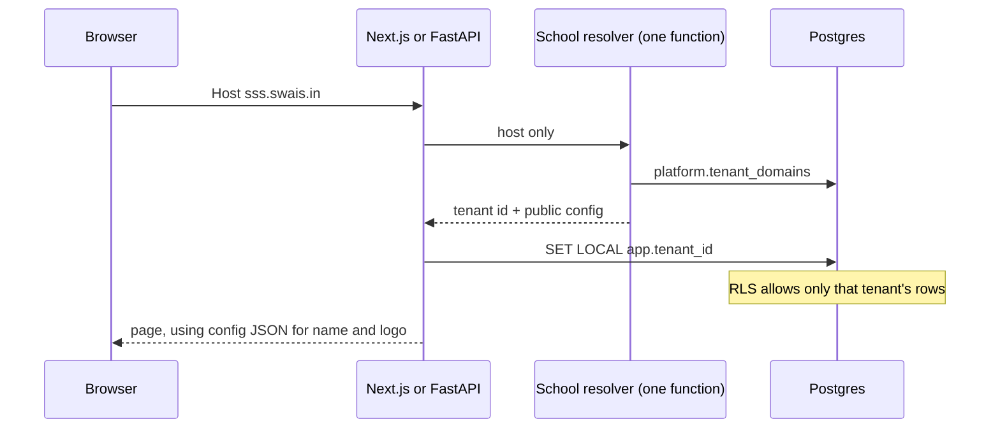

# Convert the school portals to SaaS

There is no tenant today. Each school is a separate deploy: its own database name, its own table prefix (`sgs_` or `sss_`), and its school name and logo written into the React code. This document is the implementation sequence that replaces that with one running copy of the software.

Two schools already exist. Treat them as the first two tenants, not as two products.

| School | Slug to use | What the screens say today |
| --- | --- | --- |
| SGS Senior Secondary School | `sgs` | Login title in `app/page.tsx`: "SGS Senior Secondary School", place "SHREERAMNAGAR" |
| Shiva Satya Sai School | `sss` | Headmaster sidebar: "SSS SCHOOL". Student shell: "Shiva Satya Sai School" |

After this work, adding a third school is the provisioning runbook, not another fork.

## Which repository to change

SSS is not the advanced copy of every module. Use the repository in the **Change this** column. Leave the other one frozen. Do not add tenant code to a frozen repository.

| Module | Change this | Leave frozen | Why |
| --- | --- | --- | --- |
| Login and role routing | `sgs-frontend` (this repo) | `sss_new_loginscreen` | Dashboard URLs already come from env and fall back to relative paths (`lib/role-mapping.ts`). Parents resolve against `sgs_parent_master`, not the student table. The SSS login hardcodes `https://staging.sss.swais.in/...`. |
| Student | `sgs-student-module` | `sss_student` | Progress, notification read-state, help, phone-or-email identity, i18n, and S3 study-material links are wired here. |
| Faculty API | `sgs-faculty-backend` | `sgs-backend`, `sss_faculty` backend | Full `/api/v1` surface: assignments, lesson plans, question papers, notices, S3, translation, speech. `sgs-backend` is a thinner copy of the same API. `sss_faculty` is missing those routers. |
| Faculty UI | `sgs-faculty-frontend` | `sss_faculty` frontend | Matches the faculty API, including chapters, translator, and lesson planner. |
| Headmaster | `sss-hm-dashboard` | `sgs-header-master-module` | Real API and PostgreSQL. The SGS headmaster app is an in-memory prototype. |
| Parent | `sgs-parent-module` | `sss-parent-dashboard` | JWT on the routes, ownership checks, and S3 assignment attachments. |
| Admin | `sss-admin-dashboard` | (no SGS admin app) | Only admin product. Student and parent photos already go to S3. |

Do the feature ports below **before** tenant work, in the repository you will keep. Otherwise the frozen app's screens are lost.

Port into `sgs-student-module` from `sss_student`:

- `app/chapter-upload/page.js` and `POST /chapter-pdf` (S3 `put_object` in `sss_student/backend/main.py`)
- The assignments screen and typed-answer submission (`POST /assignment-submissions`, `submission_text`)
- The assessments screen

Port into `sgs-parent-module` from `sss-parent-dashboard`:

- The newer dashboard page and `TopBar`
- Server voice routes (`voice-to-text`, `text-to-voice`)

When you port those files, delete the hardcoded school name, logo path, and `staging.sss.swais.in` host in the same change. Do not paste them into the kept repository.

From `sss_new_loginscreen`, copy only the idea that an OTP row is scoped by phone **and** role (`sss_login_otp_tokens`). Build that into this login app. Do not take its hardcoded dashboard URLs.

## Target shape

One deployment. Many school domains. Same path layout the SSS staging host already uses.

```text
https://sss.swais.in/                  login          (sgs-frontend)
https://sss.swais.in/student           student
https://sss.swais.in/faculty           faculty
https://sss.swais.in/headmaster        headmaster
https://sss.swais.in/parent            parent
https://sss.swais.in/admin             admin
https://sgs.swais.in/...               same apps, other school
https://portal.someschool.edu/...      same apps, custom domain
```

The school is the hostname. It is not the URL path, and it is not the `sgs_` / `sss_` table prefix.



## Rules

These rules are the whole design. A change that breaks one of them is not done.

1. **Read the hostname in one function.** Every app calls that function. No router, page, or SQL string inspects `Host` itself.
2. **Do not add `WHERE tenant_id = ...` to existing queries.** Postgres row-level security (RLS) applies it. The application sets `app.tenant_id` once per transaction, inside the existing connection helper.
3. **Fail closed.** An unknown host is HTTP 404. A request with no tenant id sees zero school rows. Never fall back to SGS or SSS.
4. **The browser cannot choose the tenant.** Ignore `tenant_id` in a body, query string, or header sent by the browser. The host is the source. A JWT may carry `tenant_id`, and it must equal the host's tenant or the request is HTTP 403.
5. **The API is on the same host as the page.** Keep `NEXT_PUBLIC_API_BASE_URL` and the dashboard URLs relative (`/api`, `/api/student`, `/api/v1`, `/student`, `/faculty`, ...). A shared API hostname such as `api.swais.in` would see the wrong `Host` and pick the wrong school.
6. **Public config is branding only.** School name, colors, and logo URL are JSON. Database URLs and bucket secrets are not in that JSON.
7. **New S3 keys start with `{tenant_id}/`.** One bucket. Presign a key only after it was read from a row this request is allowed to see.

## Step 1 — Shared kit

Create one repository, `swais-tenant-kit`. Every app depends on it. Do not copy the files into each app.

Install from git so you do not need a package registry yet:

```bash
pip install "git+https://github.com/sarafworldsphere/swais-tenant-kit.git@v1#subdirectory=python"
npm install "github:sarafworldsphere/swais-tenant-kit#v1"
```

### Python package `swais_tenant`

Public functions, and nothing else:

```python
def resolve_school(host: str) -> School:
    """Lookup platform.tenant_domains. Strip port, lowercase.
    Raise SchoolNotFound or SchoolSuspended. Cache for 60 seconds."""

def current_school() -> School:
    """Read the context var set by the middleware. Raise if unset."""

def open_school_session():
    """The only function that opens a school database session.
    isolation = 'rls'       -> shared engine, then SET LOCAL app.tenant_id
    isolation = 'database'  -> that school's engine, no SET LOCAL
    """
```

`School` holds `tenant_id`, `slug`, `status`, `isolation`, public `config`, and (only when `isolation == "database"`) a secret reference. The secret reference is never serialized to the browser.

FastAPI middleware, used by every backend:

```python
class SchoolMiddleware(BaseHTTPMiddleware):
    async def dispatch(self, request, call_next):
        school = resolve_school(request.headers.get("host", ""))
        token = school_ctx.set(school)
        try:
            return await call_next(request)
        finally:
            school_ctx.reset(token)
```

That middleware is the single layer. `get_db` and `get_connection` become a call to `open_school_session()`. They do not parse the host.

`SET LOCAL` lives for the current transaction only. The sessionmakers already use `autocommit=False`, so the first statement opens a transaction and the setting sticks until commit. Do not turn autocommit on. If a handler calls `commit()` and then runs more SQL, call the set again before the next statement. On a pooled connection, do not use `set_config(..., false)`: that sticks to the connection and the next request can inherit the previous school.

```python
def apply_rls(session, tenant_id: str) -> None:
    session.execute(
        text("SELECT set_config('app.tenant_id', :tenant_id, true)"),
        {"tenant_id": tenant_id},
    )
```

The lookup of the host uses a second, small connection that can read only `platform`. It runs **before** `app.tenant_id` is set. It must not be able to read `student_master` or any other school table.

### JavaScript package `@swais/tenant-kit`

```ts
export type SchoolConfig = {
  tenantId: string;
  slug: string;
  schoolName: string;
  shortName: string;
  place: string;
  logoUrl: string;       // app path, e.g. /public/brand/logo
  faviconUrl: string;
  theme: { primary: string; accent: string; background: string };
  smsSenderName: string;
  supportEmail: string;
};

export function TenantProvider(props: { config: SchoolConfig; children: React.ReactNode }): JSX.Element;
export function useSchool(): SchoolConfig;
export function SchoolBrand(props: { subtitle?: string }): JSX.Element;
```

`TenantProvider` sets these CSS variables on `documentElement` from `config.theme`:

```css
--school-primary
--school-accent
--school-background
```

`SchoolBrand` renders `config.logoUrl` and `config.schoolName`. It does not accept a school name prop. Callers pass only a subtitle such as `"Faculty"` or `"Headmaster Dashboard"`.

Each app keeps its own navigation. The menus are different. Share the brand, the theme, and the loader. Do not build one sidebar for every role.

### Loader

```ts
export async function loadSchoolConfig(host: string): Promise<SchoolConfig>
```

It calls `GET /public/tenant-config` on the **same host**. The server component reads the incoming host with `headers().get("host")` and passes it through. The handler calls `resolve_school`. It returns `config` plus `tenantId` and `slug`. It returns no database URL.

If Node fetches the API on `127.0.0.1`, set the `Host` header to the browser's host before calling `resolve_school`. Do not invent a second lookup.

## Step 2 — Control tables

Put these in schema `platform` in the shared database. RLS is **off** for this schema. The app role may `SELECT`. It may not `INSERT`. Provisioning uses a different role (see the provisioning runbook).

```sql
CREATE SCHEMA IF NOT EXISTS platform;

CREATE TABLE platform.tenants (
    tenant_id     uuid PRIMARY KEY,
    slug          text NOT NULL UNIQUE,
    status        text NOT NULL DEFAULT 'active'
                  CHECK (status IN ('active', 'suspended')),
    isolation     text NOT NULL DEFAULT 'rls'
                  CHECK (isolation IN ('rls', 'database')),
    config        jsonb NOT NULL,
    database_secret text,
    created_at    timestamptz NOT NULL DEFAULT now(),
    CONSTRAINT database_secret_only_when_isolated
        CHECK (isolation = 'database' OR database_secret IS NULL)
);

CREATE TABLE platform.tenant_domains (
    domain        text PRIMARY KEY,
    tenant_id     uuid NOT NULL REFERENCES platform.tenants (tenant_id),
    verified_at   timestamptz
);

CREATE OR REPLACE FUNCTION platform.current_tenant_id()
RETURNS uuid
LANGUAGE sql
STABLE
AS $$
    SELECT NULLIF(current_setting('app.tenant_id', true), '')::uuid
$$;

CREATE OR REPLACE FUNCTION platform.stamp_tenant_id()
RETURNS trigger
LANGUAGE plpgsql
AS $$
DECLARE
    current_tenant uuid := platform.current_tenant_id();
BEGIN
    IF current_tenant IS NULL THEN
        RAISE EXCEPTION 'app.tenant_id is not set';
    END IF;
    IF NEW.tenant_id IS NULL THEN
        NEW.tenant_id := current_tenant;
    ELSIF NEW.tenant_id IS DISTINCT FROM current_tenant THEN
        RAISE EXCEPTION 'tenant_id does not match the request school';
    END IF;
    RETURN NEW;
END
$$;
```

`config` matches the `SchoolConfig` type, without `tenantId` (that is the row's primary key). Example for the SSS school:

```json
{
  "schoolName": "Shiva Satya Sai School",
  "shortName": "SSS",
  "place": "",
  "logoUrl": "/public/brand/logo",
  "faviconUrl": "/public/brand/favicon",
  "theme": {
    "primary": "#0F172A",
    "accent": "#6366F1",
    "background": "#F8FAFC"
  },
  "smsSenderName": "SSS School",
  "supportEmail": ""
}
```

Confirm the application role cannot bypass RLS. The login pool already uses `swais_app_user`.

```sql
SELECT rolname, rolsuper, rolbypassrls
FROM pg_roles
WHERE rolname = current_user;
```

Both flags must be false for the role the apps use. `FORCE ROW LEVEL SECURITY` in the next step also covers the case where that role owns the tables. Superusers still bypass. The apps must not connect as a superuser.

Grant the app role `SELECT` on `platform.tenants` and `platform.tenant_domains` only.

## Step 3 — One schema, not a prefix per school

`DB_TABLE_PREFIX` in `sgs-parent-module/backend/database.py` and the `sgs_` / `sss_` table names are the old way of separating schools. Remove that switch. School tables live in `public` with one name each.

Build the shared schema from the kept repositories:

- Faculty models in `sgs-faculty-backend/app/models/` (`sgs_student_master`, `sgs_teacher_master`, `sgs_class_master`, `sgs_subject_master`, `sgs_chapter_master`, `sgs_chapter_content`, `sgs_assignment_master`, `sgs_assignment_results`, `sgs_assessments`, `sgs_assessment_results`, `sgs_notice_board`, `sgs_file_storage_metadata`, `sgs_users_masters`, `sgs_teacher_notes`, `sgs_teacher_lesson_plans`, `sgs_question_papers`, ...)
- Student-only tables in `sgs-student-module` (`sgs_student_learning_profiles`, `sgs_student_notification_status`, `sgs_help_support`, `sgs_ai_usage_logs`, `sgs_quiz_response`)
- Parent tables in `sgs-parent-module` (`parent_master`, `parent_student_map`, support tickets)
- Headmaster tables that exist only on the SSS side (`sss_student_marks`, `sss_function_master`, `sss_tour_master`)

Rename by dropping the `sgs_` or `sss_` prefix (`sgs_student_master` becomes `student_master`). Do this with views first if you need the old names to keep working during the deploy:

```sql
ALTER TABLE sgs_student_master RENAME TO student_master;
CREATE VIEW sgs_student_master AS SELECT * FROM student_master;
```

Drop the compatibility views once every query in the kept repositories uses the new name. Update `__tablename__` in the SQLAlchemy models and the raw SQL in:

- `sgs-student-module/backend/main.py`
- `sgs-frontend/lib/role-mapping.ts` (the `table` field of each role)
- `sss-hm-dashboard/backend` route files (raw `sss_*` SQL)
- `sss-admin-dashboard/sss-admin-backend/app/routers/admin.py` (raw `public.sss_*` SQL)
- `sgs-parent-module` models that prefix with `DB_PREFIX`

Then delete `DB_PREFIX` / `DB_TABLE_PREFIX`.

Copy the SSS school's rows in with `tenant_id` set to the SSS uuid, and the SGS rows with the SGS uuid. Where the same person exists in both databases, they are two rows. Do not merge them by email. The same email address is allowed at two schools once the unique constraints in Step 4 include `tenant_id`.

`school_id` on `sgs-faculty-backend/app/models/user.py` is unused (login returns `school_name` as `None`). Do not build tenancy on it. `tenant_id` is the column.

## Step 4 — RLS on every school table

This is one script, run against `public`. Do not write a policy by hand inside each router.

Order matters. Enabling the policy before the app sets `app.tenant_id`, or before the backfill, makes every screen empty.

1. Add a nullable `tenant_id uuid` to every ordinary table in `public`.
2. Backfill. In the database that holds SGS today, set the SGS uuid. After the SSS copy, those rows already have the SSS uuid.
3. Deploy the apps from step 5 so every session sets `app.tenant_id`.
4. Run the policy script below. It also installs the stamp trigger, so inserts after this point get `tenant_id` without a change to each INSERT.
5. Backfill any row whose `tenant_id` is still null (rows written between the first backfill and the trigger).
6. Set `tenant_id` to `NOT NULL`.

Run the script only after the backfill has committed and the apps set `app.tenant_id` on every request. Running it earlier makes every screen empty. The `ADD COLUMN` is safe to repeat.

```sql
DO $$
DECLARE
    r record;
BEGIN
    FOR r IN
        SELECT n.nspname AS schema_name, c.relname AS table_name
        FROM pg_class c
        JOIN pg_namespace n ON n.oid = c.relnamespace
        WHERE n.nspname = 'public'
          AND c.relkind = 'r'
    LOOP
        EXECUTE format(
            'ALTER TABLE %I.%I ADD COLUMN IF NOT EXISTS tenant_id uuid',
            r.schema_name, r.table_name
        );
        EXECUTE format(
            'ALTER TABLE %I.%I ENABLE ROW LEVEL SECURITY',
            r.schema_name, r.table_name
        );
        EXECUTE format(
            'ALTER TABLE %I.%I FORCE ROW LEVEL SECURITY',
            r.schema_name, r.table_name
        );
        EXECUTE format(
            'DROP POLICY IF EXISTS tenant_isolation ON %I.%I',
            r.schema_name, r.table_name
        );
        EXECUTE format(
            'CREATE POLICY tenant_isolation ON %I.%I
               USING (tenant_id = platform.current_tenant_id())
               WITH CHECK (tenant_id = platform.current_tenant_id())',
            r.schema_name, r.table_name
        );
        EXECUTE format(
            'DROP TRIGGER IF EXISTS stamp_tenant ON %I.%I',
            r.schema_name, r.table_name
        );
        EXECUTE format(
            'CREATE TRIGGER stamp_tenant
               BEFORE INSERT OR UPDATE ON %I.%I
               FOR EACH ROW EXECUTE FUNCTION platform.stamp_tenant_id()',
            r.schema_name, r.table_name
        );
    END LOOP;
END
$$;
```

`USING` hides other schools' rows on read and update. `WITH CHECK` rejects a write for another school. The trigger fills `tenant_id` when the INSERT omits it, so existing INSERT statements stay as they are.

A missing setting makes `platform.current_tenant_id()` return null, and `tenant_id = null` matches nothing. That is the fail-closed behavior. Do not add a policy that allows the row when the setting is empty.

### Foreign keys and unique emails

RLS does not fix foreign keys. Postgres checks a foreign key as the table owner, which can see the other school's row. A student at school A could be saved with school B's `class_id`.

For each foreign key in `public`, include `tenant_id` in the key:

```sql
SELECT conrelid::regclass AS table_name,
       conname,
       pg_get_constraintdef(oid)
FROM pg_constraint
WHERE contype = 'f'
  AND connamespace = 'public'::regnamespace;
```

Pattern, using class as the example:

```sql
ALTER TABLE class_master
    ADD CONSTRAINT class_master_tenant_id_key UNIQUE (tenant_id, class_id);

ALTER TABLE student_master
    DROP CONSTRAINT student_master_class_id_fkey,
    ADD CONSTRAINT student_master_class_fk
        FOREIGN KEY (tenant_id, class_id)
        REFERENCES class_master (tenant_id, class_id);
```

Repeat for every foreign key the query lists. New tables follow the same pattern from the start.

Global unique constraints must include the school, or the second school cannot register an email the first school already uses:

```sql
SELECT conrelid::regclass, conname, pg_get_constraintdef(oid)
FROM pg_constraint
WHERE contype IN ('u', 'p')
  AND connamespace = 'public'::regnamespace;
```

Change `UNIQUE (student_email)` to `UNIQUE (tenant_id, student_email)`, and the same for teacher email, parent email, phone, and `login_id`. Do this after `tenant_id` is `NOT NULL`. Postgres treats nulls as distinct, so a unique pair created while the column is still null does not protect you. Leave the existing integer primary key in place.

### Alternate: one database per school

Use this only when a school contract requires a separate database. Do not also invent a second connection style. `open_school_session()` already branches on `tenants.isolation`.

| | `isolation = 'rls'` (default) | `isolation = 'database'` |
| --- | --- | --- |
| Where rows live | One database, `tenant_id` on every table | One database per school, no `tenant_id` |
| What the session does | `SET LOCAL app.tenant_id` | Connects with that school's secret |
| RLS script | Required | Not applied in the school database |
| S3 prefix | `{tenant_id}/...` | `{tenant_id}/...` (same) |
| Branding JSON | Same `config` column | Same `config` column |
| Host lookup | `platform` schema in the shared database | `platform` stays in a small control database |

For a database-isolated school:

- Create an empty database and run the schema migrations **without** the RLS script.
- Store the connection string in a secret manager. Save the secret name in `platform.tenants.database_secret`. Do not store the URL in `config`.
- Cache one SQLAlchemy engine per tenant id inside `open_school_session()`. Cap the pool (the faculty API already sizes its pool from `max_connections` in `app/db/pool.py`; a per-school engine needs a much smaller pool, on the order of the headmaster API's `pool_size=2`).
- Run migrations once per school database when the schema changes. The provisioning runbook lists that step.

The resolver, the middleware, the S3 prefix, and the React components do not change between the two modes.

## Step 5 — Call the session helper from each app

Replace the body of the existing helper. Do not open a second engine in a router.

| App | File | Helper to switch |
| --- | --- | --- |
| Login | `sgs-frontend/lib/db.ts` | `withClient` and `query` |
| Faculty API | `sgs-faculty-backend/app/db/session.py` | `get_db` |
| Student API | `sgs-student-module/backend/main.py` | `get_connection` |
| Parent API | `sgs-parent-module/backend/database.py` | `get_db` |
| Headmaster API | `sss-hm-dashboard/backend/app/database.py` | `get_db` |
| Admin API | `sss-admin-dashboard/sss-admin-backend/app/db.py` | `get_db` |

`withClient` today returns a pooled client and the caller runs SQL. After the change it still does that, and the first statement on the client is `SELECT set_config('app.tenant_id', $1, true)`. Take the id from `current_school()`, which the Next.js middleware set from the host.

While you are in `lib/db.ts`, delete the fallback host, user, password, and database name inside `getPool()`. A missing environment variable must fail the process. Those fallbacks include a live database password. Rotate that password, because it is already in git history. Do not move the password into the tenant config JSON.

Also delete the default database URL `mydb_sgs` in `sgs-parent-module/backend/database.py`. The school is no longer implied by the database name.

Add `SchoolMiddleware` in each FastAPI `main.py`. Add the same host resolution in this repo's Next.js middleware (there is no `middleware.ts` yet; add one) so login pages and `/public/tenant-config` see the school.

Login queries in `lib/role-mapping.ts` keep their table and column names. After the rename they point at `users_masters`, `teacher_master`, `student_master`, and `parent_master`. RLS limits the lookup to the school in the host. You do not add a tenant parameter to `getRoleMapping`.

JWT for faculty (`sgs-faculty-backend`, claim `teacher_id`) and parent (`sgs-parent-module`) gains `tenant_id`. On each request, after `resolve_school`, reject the token when `token.tenant_id` is not the host's tenant. Issue the token only from a session that already has RLS applied, so the login cannot see another school's user.

Headmaster routes in `sss-hm-dashboard` currently have no JWT check (`useAuthGuard` redirect is commented out). Turn that guard back on as part of this work, using the same token rule. An unauthenticated headmaster API on a shared database is a cross-school leak even with RLS, because a caller who can hit the API is still inside whichever school the host resolved.

`SCHOOL_NAME` in `sgs-faculty-backend/app/core/config.py` is read by the lesson-plan masthead (`app/services/ai_service.py`). Read `current_school().config["schoolName"]` instead. Delete the env var when nothing else reads it.

Admin `GET /api/admin/config` in `sss-admin-backend/app/routers/admin.py` currently returns only `logout_url`. Extend that response with the public `SchoolConfig`, or stop using it and call `GET /public/tenant-config` from the admin shell. One of the two, not a third shape.

## Step 6 — S3 keys

One private bucket. Every new key:

```text
{tenant_id}/study-material/class-{id}/subject-{id}/chapter-{id}/{file}
{tenant_id}/assignments/class-{id}/assignment-{id}/{file}
{tenant_id}/chapters/class-{id}/subject-{id}/chapter-{id}/{file}
{tenant_id}/admin/students/{student_id}/student/{file}
{tenant_id}/admin/parents/{parent_id}/profile/{file}
{tenant_id}/brand/logo
{tenant_id}/brand/favicon
```

Put the builder in the Python kit and delete the local ones.

| Current builder | File | Change |
| --- | --- | --- |
| Faculty study material and assignments | `sgs-faculty-backend/app/services/s3_service.py` `build_key`, `build_assignment_key` | Prefix with `current_school().tenant_id`. Keep the rest of the path. |
| Admin photos | `sss-admin-backend/app/routers/admin.py` (keys start with `sss/admin/students/` and `sss/admin/parents/`) | Replace the `sss/admin` prefix with `{tenant_id}/admin`. |
| Student chapter PDF, once ported | `sss_student/backend/main.py` writes `chapters/class-...` | Use the shared builder. Do not copy the unprefixed key. |
| Student assignment files stored as `bytea` | `sgs-student-module/backend/main.py` `submitted_file_content` | Leave existing bytes in Postgres. New submissions use the shared builder and store an `s3://` URI, the way faculty files already do in `sgs_file_storage_metadata.file_url`. |

`presign_get` stays. The bucket stays private. Rules for the presign function:

- The key comes from a column just read in this request (`file_url`, `student_photo_key`, ...), never from the browser.
- A new key must start with `{tenant_id}/`. Reject anything else.
- A legacy key (`study-material/...`, `assignments/...`, `sss/admin/...`, `chapters/...`) may be presigned only when it was loaded from a row RLS already allowed. Schedule a copy to the new prefix later; do not block the conversion on that copy.

Brand images are not stored as expiring URLs inside `config`. `config.logoUrl` is the path `/public/brand/logo`. That route calls `resolve_school`, then presigns `{tenant_id}/brand/logo`, and redirects. The JSON can be cached. The presign cannot.

Faculty and student clients already send the file to the API and the API calls `put_object`. Keep it that way. Do not hand the browser a bucket credential.

## Step 7 — Render the school from JSON

Each layout loads config once and wraps the tree.

```tsx
const config = await loadSchoolConfig(host);
return (
  <TenantProvider config={config}>
    {children}
  </TenantProvider>
);
```

Replace the hardcoded brand in these places with `<SchoolBrand subtitle="..." />`. Delete the string and the static logo import in the same edit.

| Screen | File | Remove |
| --- | --- | --- |
| Login | `sgs-frontend/app/page.tsx` | ``, "SGS Senior Secondary School", "SHREERAMNAGAR" |
| Login SMS | `sgs-frontend/lib/nimbus-sms.ts` | The sender text "SGS School". Use `config.smsSenderName`. |
| Student shell | `sgs-student-module/app/dashboard-shell.js` | `sgslogo.jpeg` and alt text "SGS Senior Secondary School logo" |
| Student title | `sgs-student-module/app/layout.js` | `"SWAIS Dashboard"` becomes `config.schoolName` |
| Faculty sidebar | `sgs-faculty-frontend/src/components/layout/Sidebar.js` | `/sgs-logo.png`, "SGS Portal" |
| Parent sidebar | `sgs-parent-module/frontend/src/components/Sidebar.tsx` | `/parent/logo.jpeg` |
| Headmaster sidebar | `sss-hm-dashboard/frontend/components/Sidebar.jsx` | `/headmaster/school-logo.jpeg`, "SSS SCHOOL" |
| Headmaster logout | same file | `window.location.href = "https://staging.sss.swais.in"` becomes `/` on the current host |
| Admin shell | `sss-admin-dashboard/sss-admin-frontend/components/layout/AdminShell.js` | `NEXT_PUBLIC_SCHOOL_NAME` default `"SSS School"` |
| Admin copy | `sss-admin-frontend/app/admin/components/students/Students.jsx` | "SSS School" in the subtitle |

Map existing colors onto the variables instead of new one-off hex values:

- Faculty sidebar background `#0F172A` and accent `#6366F1` become `var(--school-primary)` and `var(--school-accent)`.
- Those hex values move into the SGS and SSS `config.theme` rows, so the first two schools look the same on day one.

Logout from every module goes to `/` on the current host. Delete `NEXT_PUBLIC_SCHOOL_NAME`, `logout_redirect_url` default `https://staging.sss.swais.in/`, and any other absolute staging host. This login app's `dashboardUrls` in `lib/role-mapping.ts` already fall back to relative paths. Keep that. Set the env overrides to relative paths too.

`app/page.tsx` reads the school name from `useSchool()` inside the client tree. The server layout fetches the config. Do not pass the school name as a prop from a constant.

## Step 8 — Tests

Add these before calling the conversion done. They are the acceptance tests.

1. Insert one student in school A and one in school B. `GET /students` with `Host: a.swais.in` returns only A. Repeat for B.
2. The SQL text of that route does not contain `tenant_id`. Show the diff.
3. Open a session with no `set_config`. A select on `student_master` returns zero rows. An insert raises `app.tenant_id is not set`.
4. Insert with an explicit `tenant_id` of the other school. The trigger rejects it.
5. A faculty JWT from school A, sent to school B's host, returns 403.
6. `GET /public/tenant-config` with `Host: sss.swais.in` returns "Shiva Satya Sai School". The body has no `database_secret` and no connection string.
7. Upload a chapter file. The key starts with the tenant uuid. A presign request that passes a key in the body is rejected.
8. Render the login page with a fixture config whose `schoolName` is `"Example School"`. The HTML contains that name and does not contain "SGS Senior Secondary School" or "SSS SCHOOL".
9. For a database-isolated school, the same student request hits that school's database and does not run `set_config`.

## Order of work

Do it in this order. Later steps assume the earlier ones.

1. Feature ports listed at the top (student chapter upload, assignments, assessments; parent dashboard and voice).
2. `swais-tenant-kit` with the resolver, `open_school_session`, S3 builder, and `SchoolBrand`.
3. `platform` tables, and the two tenant rows for `sgs` and `sss` (provisioning runbook, first-school section).
4. Rename tables, backfill `tenant_id`, then enable RLS.
5. Switch the six connection helpers and add the middleware.
6. S3 prefix on new uploads, brand route, delete hardcoded names.
7. Acceptance tests above.
8. Provision an empty third school with no code change. That is the test that onboarding works. The steps are in [02-school-provisioning.md](./02-school-provisioning.md).

## Done when

- Unknown hosts return 404. There is no default school.
- A developer can search the six kept repositories for `SGS Senior Secondary School`, `SSS SCHOOL`, `Shiva Satya Sai`, `sgslogo`, `sgs-logo`, and `staging.sss.swais.in` and find none of them in UI or redirect code.
- A developer can search school queries for a hand-written `tenant_id` filter and find none. The policy and the trigger are the only enforcement.
- `sgs_` and `sss_` are not used as the way to separate schools. They are gone from table names, or they exist only as temporary compatibility views with a deletion date.
- A new school is a row in `platform.tenants`, a domain row, a logo object, and a DNS record.
