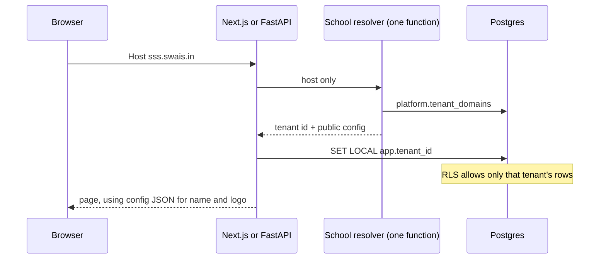

# Convert the school portals to SaaS

There is no tenant today. Each school is a separate deploy: its own database name, its own table prefix (`sgs_` or `sss_`), and its school name and logo written into the React code. This document is the implementation sequence that replaces that with one running copy of the software.

Two schools already exist. Treat them as the first two tenants, not as two products.

| School | Slug to use | What the screens say today |
| --- | --- | --- |
| SGS Senior Secondary School | `sgs` | Login title in `app/page.tsx`: "SGS Senior Secondary School", place "SHREERAMNAGAR" |
| Shiva Satya Sai School | `sss` | Headmaster sidebar: "SSS SCHOOL". Student shell: "Shiva Satya Sai School" |

After this work, adding a third school is the provisioning runbook, not another fork.

## Which repository to change

SSS is not the advanced copy of every module. Use the repository in the **Change this** column. Leave the other one frozen. Do not add tenant code to a frozen repository.

| Module | Change this | Leave frozen | Why |
| --- | --- | --- | --- |
| Login and role routing | `sgs-frontend` (this repo) | `sss_new_loginscreen` | Dashboard URLs already come from env and fall back to relative paths (`lib/role-mapping.ts`). Parents resolve against `sgs_parent_master`, not the student table. The SSS login hardcodes `https://staging.sss.swais.in/...`. |
| Student | `sgs-student-module` | `sss_student` | Progress, notification read-state, help, phone-or-email identity, i18n, and S3 study-material links are wired here. |
| Faculty API | `sgs-faculty-backend` | `sgs-backend`, `sss_faculty` backend | Full `/api/v1` surface: assignments, lesson plans, question papers, notices, S3, translation, speech. `sgs-backend` is a thinner copy of the same API. `sss_faculty` is missing those routers. |
| Faculty UI | `sgs-faculty-frontend` | `sss_faculty` frontend | Matches the faculty API, including chapters, translator, and lesson planner. |
| Headmaster | `sss-hm-dashboard` | `sgs-header-master-module` | Real API and PostgreSQL. The SGS headmaster app is an in-memory prototype. |
| Parent | `sgs-parent-module` | `sss-parent-dashboard` | JWT on the routes, ownership checks, and S3 assignment attachments. |
| Admin | `sss-admin-dashboard` | (no SGS admin app) | Only admin product. Student and parent photos already go to S3. |

Do the feature ports below **before** tenant work, in the repository you will keep. Otherwise the frozen app's screens are lost.

Port into `sgs-student-module` from `sss_student`:

- `app/chapter-upload/page.js` and `POST /chapter-pdf` (S3 `put_object` in `sss_student/backend/main.py`)
- The assignments screen and typed-answer submission (`POST /assignment-submissions`, `submission_text`)
- The assessments screen

Port into `sgs-parent-module` from `sss-parent-dashboard`:

- The newer dashboard page and `TopBar`
- Server voice routes (`voice-to-text`, `text-to-voice`)

When you port those files, delete the hardcoded school name, logo path, and `staging.sss.swais.in` host in the same change. Do not paste them into the kept repository.

From `sss_new_loginscreen`, copy only the idea that an OTP row is scoped by phone **and** role (`sss_login_otp_tokens`). Build that into this login app. Do not take its hardcoded dashboard URLs.

## Target shape

One deployment. Many school domains. Same path layout the SSS staging host already uses.

```text
https://sss.swais.in/                  login          (sgs-frontend)
https://sss.swais.in/student           student
https://sss.swais.in/faculty           faculty
https://sss.swais.in/headmaster        headmaster
https://sss.swais.in/parent            parent
https://sss.swais.in/admin             admin
https://sgs.swais.in/...               same apps, other school
https://portal.someschool.edu/...      same apps, custom domain
```

The school is the hostname. It is not the URL path, and it is not the `sgs_` / `sss_` table prefix.



## Rules

These rules are the whole design. A change that breaks one of them is not done.

1. **Read the hostname in one function.** Every app calls that function. No router, page, or SQL string inspects `Host` itself.
2. **Do not add `WHERE tenant_id = ...` to existing queries.** Postgres row-level security (RLS) applies it. The application sets `app.tenant_id` once per transaction, inside the existing connection helper.
3. **Fail closed.** An unknown host is HTTP 404. A request with no tenant id sees zero school rows. Never fall back to SGS or SSS.
4. **The browser cannot choose the tenant.** Ignore `tenant_id` in a body, query string, or header sent by the browser. The host is the source. A JWT may carry `tenant_id`, and it must equal the host's tenant or the request is HTTP 403.
5. **The API is on the same host as the page.** Keep `NEXT_PUBLIC_API_BASE_URL` and the dashboard URLs relative (`/api`, `/api/student`, `/api/v1`, `/student`, `/faculty`, ...). A shared API hostname such as `api.swais.in` would see the wrong `Host` and pick the wrong school.
6. **Public config is branding only.** School name, colors, and logo URL are JSON. Database URLs and bucket secrets are not in that JSON.
7. **Every S3 key starts with `{tenant_id}/`.** One bucket. The module that owns an existing object copies it under that prefix and rewrites the column that stores the key before its reader is switched. Presign a key only after it was read from a row this request is allowed to see.

## Step 1 — Shared kit

The shared kit is [saraswati-tenant-kit](https://github.com/SarafWorldsphere/saraswati-tenant-kit). Every app depends on it. Do not copy the files into each app.

Install from git so you do not need a package registry yet. Use SSH when this machine already has a GitHub key. Use HTTPS when you sign in with `gh auth login`.

SSH:

```bash
pip install "git+ssh://git@github.com/SarafWorldsphere/saraswati-tenant-kit.git@main#subdirectory=python"
npm install "github:SarafWorldsphere/saraswati-tenant-kit#main"
```

HTTPS, after `gh auth login`:

```bash
gh auth login
pip install "git+https://github.com/SarafWorldsphere/saraswati-tenant-kit.git@main#subdirectory=python"
npm install "git+https://github.com/SarafWorldsphere/saraswati-tenant-kit.git#main"
```

### Python package `saraswati_tenant`

```python
from saraswati_tenant import (
    SchoolMiddleware,
    apply_rls,
    s3_path_validator,
    build_key,
    current_school,
    open_school_session,
    resolve_school,
)
```

`resolve_school(host)` reads `platform.tenant_domains`. It strips the port, lowercases the host, and caches for 60 seconds. An unknown host raises `SchoolNotFound` (HTTP 404). A suspended school raises `SchoolSuspended` (HTTP 403).

`current_school()` reads the context var the middleware set.

`open_school_session()` opens the psycopg connection for that school and sets `app.tenant_id` for the transaction. `isolation = 'rls'` uses `SARASWATI_DATABASE_URL`. `isolation = 'database'` uses the URL mapped from `database_secret` in `SARASWATI_DATABASE_SECRETS`. Both modes set `app.tenant_id`, because both databases run the same row-level security migration.

`apply_rls(db)` is the same `set_config` call for a SQLAlchemy session, used inside the existing `get_db` helpers.

`build_key("brand", "logo")` returns `{tenant_id}/brand/logo`. `s3_path_validator(key, tenant_id)` accepts that key only when it starts with `{tenant_id}/`. There is no allowlist of older prefixes.

`SchoolMiddleware` is the single layer. `get_db` and `get_connection` call `open_school_session()` or `apply_rls()`. They do not parse the host.

`set_config(..., true)` lasts for the current transaction. The sessionmakers already use `autocommit=False`. If a handler calls `commit()` and then runs more SQL, call `apply_rls` again before the next statement. Do not use `set_config(..., false)` on a pooled connection. That sticks to the connection and the next request can inherit the previous school.

The domain lookup uses `SARASWATI_CONTROL_DATABASE_URL` (or the shared URL) and reads only `platform`. It runs before `app.tenant_id` is set. The app role can `SELECT` that schema and cannot `INSERT` into it.

### JavaScript package `@saraswati/tenant-kit`

`TenantProvider`, `useSchool`, `SchoolBrand`, and `loadSchoolConfig` are exported from the package. `SchoolConfig` is `tenantId`, `slug`, `schoolName`, `shortName`, `place`, `logoUrl`, `faviconUrl`, `theme`, `smsSenderName`, and `supportEmail`.

`TenantProvider` sets `--school-primary`, `--school-accent`, and `--school-background` from `config.theme`.

`SchoolBrand` renders `config.logoUrl` and `config.schoolName`. It does not accept a school name prop. Callers pass only a subtitle such as `"Faculty"` or `"Headmaster Dashboard"`.

Each app keeps its own navigation. The menus are different. Share the brand, the theme, and the loader. Do not build one sidebar for every role.

`loadSchoolConfig(host)` requests `{proto}://{host}/public/tenant-config`. The handler calls `resolve_school` and returns `School.public_config()`. That body has `tenantId` and `slug` and has no database secret. Set `SARASWATI_PUBLIC_PROTO=http` on a local machine. The server component passes `headers().get("host")` through. Do not invent a second lookup.

## Step 2 — Control tables

Apply them from the kit. Do not paste a second copy into an app repository.

```bash
DATABASE_URL=postgresql://... ./scripts/apply.sh
```

That runs `src/` first (table definitions and indexes), then `migrations/`. The control plane is `src/10_platform.sql`: `platform.tenants` and `platform.tenant_domains`. Row-level security stays off for `platform`. `migrations/0002_app_grants.sql` lets `saraswati_app` select those two tables and does not let it insert. Provisioning uses the database owner (see the provisioning runbook).

`migrations/0001_row_level_security.sql` creates `platform.current_tenant_id()` and `platform.stamp_tenant_id()`. Those functions are not in `src/`, because they run after the tables exist.

`config` matches the `SchoolConfig` type, without `tenantId` (that is the row's primary key). Example for the SSS school:

```json
{
  "schoolName": "Shiva Satya Sai School",
  "shortName": "SSS",
  "place": "",
  "logoUrl": "/public/brand/logo",
  "faviconUrl": "/public/brand/favicon",
  "theme": {
    "primary": "#0F172A",
    "accent": "#6366F1",
    "background": "#F8FAFC"
  },
  "smsSenderName": "SSS School",
  "supportEmail": ""
}
```

Confirm the application role cannot bypass RLS. The login pool already uses `swais_app_user`.

```sql
SELECT rolname, rolsuper, rolbypassrls
FROM pg_roles
WHERE rolname = current_user;
```

Both flags must be false for the role the apps use. `FORCE ROW LEVEL SECURITY` in the next step also covers the case where that role owns the tables. Superusers still bypass. The apps must not connect as a superuser.

Grant the app role `SELECT` on `platform.tenants` and `platform.tenant_domains` only.

## Step 3 — One schema, not a prefix per school

`DB_TABLE_PREFIX` in `sgs-parent-module/backend/database.py` and the `sgs_` / `sss_` table names are the old way of separating schools. Remove that switch. The tables you create are the ones in `saraswati-tenant-kit/src/`. They are unprefixed, each school column is `tenant_id`, and every foreign key is `(tenant_id, id)` so a row cannot point at another school's parent.

`scripts/apply.sh` creates them with `tenant_id` already `NOT NULL`, with the unique pairs and the indexes. Do not hand-write a second `CREATE TABLE`.

Point the app queries at those names. Update `__tablename__` and the raw SQL in:

- `sgs-student-module/backend/main.py`
- `sgs-frontend/lib/role-mapping.ts` (the `table` field of each role)
- `sss-hm-dashboard/backend` route files (raw `sss_*` SQL)
- `sss-admin-dashboard/sss-admin-backend/app/routers/admin.py` (raw `public.sss_*` SQL)
- `sgs-parent-module` models that prefix with `DB_PREFIX`

Then delete `DB_PREFIX` / `DB_TABLE_PREFIX`.

Two column renames the admin and headmaster SQL must follow, because the kit uses one name:

| Current | Kit |
| --- | --- |
| `sss_student_master.name` | `student_master.full_name` |
| `sss_student_master.roll_number` | `student_master.roll_no` |
| `sss_users_master` | `users_masters` (`username` and `role` are on that table) |

`student_master` also has `gender`, `class_name`, and `student_photo_key`, which the admin app already writes.

Copy the SSS school's rows in with `tenant_id` set to the SSS uuid, and the SGS rows with the SGS uuid. Do the copy inside a transaction that has called `set_config('app.tenant_id', ..., true)`, because the policy is already on after `apply.sh`. Where the same person exists in both databases, they are two rows. Do not merge them by email. The same email is allowed at two schools: the unique indexes are `(tenant_id, student_email)` and the same shape for teacher email, parent email, and `login_id`.

`school_id` on `sgs-faculty-backend/app/models/user.py` is unused (login returns `school_name` as `None`). Do not build tenancy on it. `tenant_id` is the column. The kit does not have `school_id`.

## Step 4 — RLS on every school table

The policy is `migrations/0001_row_level_security.sql`. `apply.sh` runs it after `src/`. Do not write a policy by hand inside each router.

The migration enables and forces row-level security on every `public` table that has `tenant_id`, creates one policy named `tenant_isolation`, and adds the `stamp_tenant` trigger. The policy compares `tenant_id` to `(SELECT platform.current_tenant_id())`, so the setting is read once per query rather than once per row.

`USING` hides other schools' rows. `WITH CHECK` rejects a write for another school. The trigger fills `tenant_id` when the INSERT omits it, and rejects an INSERT that names a different school.

A missing setting makes `platform.current_tenant_id()` return null, and `tenant_id = null` matches nothing. That is the fail-closed behavior.

On a database that already ran `apply.sh`, do not run a second script that adds `tenant_id`. The column, the unique pair, and the foreign keys are already in `src/`.

### Alternate: one database per school

Use this only when a school contract requires a separate database. Run the same `scripts/apply.sh` against that database, including `migrations/0001_row_level_security.sql`. The tables still have `tenant_id`. `open_school_session()` still sets `app.tenant_id`. The only difference is which database it connects to.

| | `isolation = 'rls'` (default) | `isolation = 'database'` |
| --- | --- | --- |
| Where rows live | The shared database | `school_<slug>`, created empty, then `apply.sh` |
| What the session does | Sets `app.tenant_id` on the shared pool | Sets `app.tenant_id` on that school's pool (max 2 connections) |
| Schema | `src/` plus `migrations/` | The same files |
| S3 prefix | `{tenant_id}/...` | `{tenant_id}/...` |
| Branding JSON | `platform.tenants.config` in the control database | The same control row. `database_secret` names the secret, not the URL |
| Host lookup | `platform.tenant_domains` | The same lookup. The control database stays shared |

Store the connection string in a secret manager. Save the secret name in `platform.tenants.database_secret`. Map it for the process with `SARASWATI_DATABASE_SECRETS`. Do not store the URL in `config`.

When the schema changes, run the new kit files on the shared database and on every database where `isolation = 'database'`.

The resolver, the middleware, the S3 prefix, and the React components do not change between the two modes.

## Step 5 — Call the session helper from each app

Replace the body of the existing helper. Do not open a second engine in a router.

| App | File | Helper to switch |
| --- | --- | --- |
| Login | `sgs-frontend/lib/db.ts` | `withClient` and `query` |
| Faculty API | `sgs-faculty-backend/app/db/session.py` | `get_db` |
| Student API | `sgs-student-module/backend/main.py` | `get_connection` |
| Parent API | `sgs-parent-module/backend/database.py` | `get_db` |
| Headmaster API | `sss-hm-dashboard/backend/app/database.py` | `get_db` |
| Admin API | `sss-admin-dashboard/sss-admin-backend/app/db.py` | `get_db` |

### Same two calls in every module

Each module does these two things and writes no other tenant logic. The first call reads `Host`. The second call sets `app.tenant_id` on the connection the module already opens. A page, a router, and a SQL string do not read `Host`.

A FastAPI module (faculty, student, parent, headmaster, admin) adds the middleware in `main.py` and calls one helper inside the `get_db` or `get_connection` it already has. `SchoolMiddleware` is the `Host` read. `apply_rls` is the SQLAlchemy form. `open_school_session` is the raw-connection form. Use the one that matches the file in the table.

```python
from fastapi import FastAPI
from saraswati_tenant import SchoolMiddleware, apply_rls, open_school_session

app = FastAPI()
app.add_middleware(SchoolMiddleware)

def get_db():
    db = SessionLocal()
    try:
        apply_rls(db)
        yield db
    finally:
        db.close()

def get_connection():
    with open_school_session() as connection:
        yield connection
```

A Next.js module has no `SchoolMiddleware` in the JavaScript package, so the same two calls are three files. `lib/school.ts` is the only lookup. `proxy.ts` is the only `Host` read. `lib/db.ts` sets `app.tenant_id` and does not read `Host`.

`proxy.ts` deletes `x-saraswati-tenant-id` before it sets the id it just resolved. A value sent by the browser does not survive that delete. `lib/db.ts` reads the header the proxy set. `set_config(..., true)` is transaction-local, so the helper opens a transaction, sets the id, runs the caller's SQL, then commits.

```typescript
// lib/school.ts
import { Pool } from "pg";

const pool = new Pool({ connectionString: process.env.SARASWATI_DATABASE_URL });

export type ResolvedSchool = { tenantId: string; status: string };

export async function resolveSchool(host: string): Promise<ResolvedSchool | null> {
  const domain = host.trim().toLowerCase().replace(/\.$/, "").split(":")[0];
  if (!domain || domain.includes("/")) return null;
  const result = await pool.query(
    `SELECT t.tenant_id::text AS "tenantId", t.status
     FROM platform.tenant_domains AS d
     JOIN platform.tenants AS t ON t.tenant_id = d.tenant_id
     WHERE d.domain = $1`,
    [domain],
  );
  return result.rows[0] ?? null;
}
```

```typescript
// proxy.ts
import { NextResponse } from "next/server";
import { auth } from "@/auth";
import { resolveSchool } from "@/lib/school";

const TENANT_HEADER = "x-saraswati-tenant-id";

export const proxy = auth(async (request) => {
  const school = await resolveSchool(request.headers.get("host") ?? "");
  if (!school) return new NextResponse(null, { status: 404 });
  if (school.status !== "active") return new NextResponse(null, { status: 403 });
  const headers = new Headers(request.headers);
  headers.delete(TENANT_HEADER);
  headers.set(TENANT_HEADER, school.tenantId);
  return NextResponse.next({ request: { headers } });
});
```

```typescript
// lib/db.ts — withClient and query both use bindTenant
import { headers } from "next/headers";
import { Pool, PoolClient } from "pg";

const TENANT_HEADER = "x-saraswati-tenant-id";

async function bindTenant(client: PoolClient): Promise<void> {
  const tenantId = (await headers()).get(TENANT_HEADER);
  if (!tenantId) throw new Error("School was not resolved for this request.");
  await client.query("BEGIN");
  await client.query("SELECT set_config('app.tenant_id', $1, true)", [tenantId]);
}

export async function withClient<T>(callback: (client: PoolClient) => Promise<T>): Promise<T> {
  const client = await getPool().connect();
  try {
    await bindTenant(client);
    const result = await callback(client);
    await client.query("COMMIT");
    return result;
  } catch (error) {
    await client.query("ROLLBACK");
    throw error;
  } finally {
    client.release();
  }
}
```

While you are in `lib/db.ts`, delete the fallback host, user, password, and database name inside `getPool()`. A missing environment variable must fail the process. Those fallbacks include a live database password. Rotate that password, because it is already in git history. Do not move the password into the tenant config JSON.

Also delete the default database URL `mydb_sgs` in `sgs-parent-module/backend/database.py`. The school is no longer implied by the database name.

The FastAPI block above is the `main.py` and the connection helper for the five Python apps. Branch `saas` in this repo already contains the Next.js block: `lib/school.ts`, `proxy.ts`, `lib/db.ts`, the role-table rename, `GET /public/tenant-config`, and `SchoolBrand` on the login page. The block stays here so another Next.js app can copy that shape.

Login queries in `lib/role-mapping.ts` keep their table and column names. After the rename they point at `users_masters`, `teacher_master`, `student_master`, and `parent_master`. RLS limits the lookup to the school in the host. You do not add a tenant parameter to `getRoleMapping`.

JWT for faculty (`sgs-faculty-backend`, claim `teacher_id`) and parent (`sgs-parent-module`) gains `tenant_id`. On each request, after `resolve_school`, reject the token when `token.tenant_id` is not the host's tenant. Issue the token only from a session that already has RLS applied, so the login cannot see another school's user.

Headmaster routes in `sss-hm-dashboard` currently have no JWT check (`useAuthGuard` redirect is commented out). Turn that guard back on as part of this work, using the same token rule. An unauthenticated headmaster API on a shared database is a cross-school leak even with RLS, because a caller who can hit the API is still inside whichever school the host resolved.

`SCHOOL_NAME` in `sgs-faculty-backend/app/core/config.py` is read by the lesson-plan masthead (`app/services/ai_service.py`). Read `current_school().config["schoolName"]` instead. Delete the env var when nothing else reads it.

Admin `GET /api/admin/config` in `sss-admin-backend/app/routers/admin.py` currently returns only `logout_url`. Extend that response with the public `SchoolConfig`, or stop using it and call `GET /public/tenant-config` from the admin shell. One of the two, not a third shape.

## Step 6 — Move the live S3 objects, then write tenant-prefixed keys

Only SGS is live. The private bucket is `sgs-bucket-images` in `ap-south-2`. Copy each object under the SGS tenant id and rewrite the column that stores the key in the same change that switches the writer. Deploy that change before any reader calls `s3_path_validator`. The kit accepts a key only when it starts with `{tenant_id}/`. Do not add an exception for the old prefixes in the kit or in a presign function.

`build_key` is the only key builder. Delete the local builders after the copy. The school id is the first segment. The rest of the path stays the path the module already uses.

```python
build_key("study-material", f"class-{class_id}", f"subject-{subject_id}", f"chapter-{chapter_id}", filename)
build_key("assignments", f"class-{class_id}", f"assignment-{assignment_id}", filename)
build_key("student-photos", filename)
build_key("chapters", f"class-{class_id}", f"subject-{subject_id}", f"chapter-{chapter_id}", filename)
build_key("admin", "students", str(student_id), "student", filename)
build_key("admin", "parents", str(parent_id), "profile", filename)
build_key("brand", "logo")
```

### What is in `sgs-bucket-images` today

The console listing at the bucket root is three folders and loose parent photos. There is no `chapters/` folder and no `sss/` folder in that listing.

```text
sgs-bucket-images/
  assignments/
    class-18/
      assignment-117/
        {file}
  study-material/
    class-7/
      subject-29/
        chapter-245/
          3f90d62e47a5-Chapter_01.pdf
  student-photos/
    1784796691389-tki6ot.jpeg
    1784796691695-3pnchd.jpeg
    1784797463040-np0owg.jpeg
    1784797463558-f479ld.jpeg
    1784805326080-2anowb.jpeg
    1784805326349-ju1ak8.jpeg
    _keytest-1785480752037.txt
  father-1784747197741-images-(1).jpeg
  father-1784788578513-images-(1).jpeg
  mother-1784747198406-images-(2).jpeg
  mother-1784788578927-images-(2).jpeg
```

List the bucket again before you copy. The filenames above are the objects visible on 16 October 2026. The folder shape is what you match. A newer file under the same folders moves the same way.

| Prefix in the bucket | Shape | Example |
| --- | --- | --- |
| `study-material/` | `study-material/class-{class_id}/subject-{subject_id}/chapter-{chapter_id}/{file}` | `study-material/class-7/subject-29/chapter-245/3f90d62e47a5-Chapter_01.pdf` |
| `assignments/` | `assignments/class-{class_id}/assignment-{assignment_id}/{file}` | `assignments/class-18/assignment-117/{file}` |
| `student-photos/` | `student-photos/{epoch}-{token}.jpeg` | `student-photos/1784796691389-tki6ot.jpeg` |
| bucket root | `father-{epoch}-images-(1).jpeg` and `mother-{epoch}-images-(2).jpeg` | `father-1784747197741-images-(1).jpeg` |

`student-photos/_keytest-1785480752037.txt` is a probe. Delete it after you confirm no column stores that key. Do not copy it under the tenant prefix.

Two writers exist in code and have no folder in this listing. Move an object of that shape only when a column still points at it:

| Writer | Key the code writes today | Where |
| --- | --- | --- |
| Admin photo upload | `sss/admin/students/{student_id}/student/{uuid}{ext}` and `sss/admin/parents/{parent_id}/profile/{uuid}{ext}` | `sss-admin-dashboard/sss-admin-backend/app/routers/admin.py` |
| Chapter PDF upload, frozen app | `chapters/class-{class_id}/subject-{subject_id}/chapter-{chapter_id}/{file}` | `sss_student/backend/main.py` |

### Target layout

Every object, including a file that sits at the bucket root today, starts with the SGS tenant uuid. Prepend `{tenant_id}/` and keep the rest of the key. The one exception is a key that still begins with `sss/admin/`: drop the `sss/` slug, because the tenant id replaces the school name.

```text
{tenant_id}/study-material/class-{class_id}/subject-{subject_id}/chapter-{chapter_id}/{file}
{tenant_id}/assignments/class-{class_id}/assignment-{assignment_id}/{file}
{tenant_id}/student-photos/{file}
{tenant_id}/father-{epoch}-images-(1).jpeg
{tenant_id}/mother-{epoch}-images-(2).jpeg
{tenant_id}/chapters/class-{class_id}/subject-{subject_id}/chapter-{chapter_id}/{file}
{tenant_id}/admin/students/{student_id}/student/{file}
{tenant_id}/admin/parents/{parent_id}/profile/{file}
{tenant_id}/brand/logo
{tenant_id}/brand/favicon
```

Worked examples for objects that are in the bucket now:

```text
study-material/class-7/subject-29/chapter-245/3f90d62e47a5-Chapter_01.pdf
  → {tenant_id}/study-material/class-7/subject-29/chapter-245/3f90d62e47a5-Chapter_01.pdf

assignments/class-18/assignment-117/{file}
  → {tenant_id}/assignments/class-18/assignment-117/{file}

student-photos/1784796691389-tki6ot.jpeg
  → {tenant_id}/student-photos/1784796691389-tki6ot.jpeg

father-1784747197741-images-(1).jpeg
  → {tenant_id}/father-1784747197741-images-(1).jpeg
```

A stored URI gains the same segment after the bucket name:

```text
s3://sgs-bucket-images/study-material/class-7/subject-29/chapter-245/3f90d62e47a5-Chapter_01.pdf
  → s3://sgs-bucket-images/{tenant_id}/study-material/class-7/subject-29/chapter-245/3f90d62e47a5-Chapter_01.pdf
```

### Who moves which objects

Do the copy in the repository in the **Change this** column. The frozen repository is the place to read the old writer. Do not add the copy script there.

| Module | Owns these objects | Column that stores the key | Change this |
| --- | --- | --- | --- |
| Faculty | `study-material/...` and `assignments/...` | `sgs_file_storage_metadata.file_url`, an `s3://sgs-bucket-images/{key}` URI. `entity_type` is `CHAPTER_STUDY_MATERIAL` or `ASSIGNMENT_ATTACHMENT`. | `sgs-faculty-backend`. Delete `build_key` and `build_assignment_key` in `app/services/s3_service.py`. |
| Admin | `student-photos/...`, root `father-` and `mother-` jpegs, and any `sss/admin/...` key a row still stores | `sss_student_master.student_photo_key` and `sss_parent_master.profile_image`. After the rename those columns are `student_master.student_photo_key` and `parent_master.profile_image`. They store the key, not an `s3://` URI. | `sss-admin-dashboard`. The upload in `sss-admin-backend/app/routers/admin.py` writes `sss/admin/...` today. |
| Student | `chapters/...` if a row already points at one. The SGS listing has none. | `sss_chapter_content.pdf_url` (`chapter_content.pdf_url` after the rename), an `s3://` URI. | `sgs-student-module`, when you port `POST /chapter-pdf` from `sss_student/backend/main.py`. |
| Student submissions | No S3 object. The file bytes are in Postgres. | `submitted_file_content` in `sgs-student-module/backend/main.py`. | Leave the bytes. New submissions use `build_key("assignments", ...)` and store an `s3://` URI in the same shape faculty already uses. |
| Parent | None. It presigns the faculty row. | Reads `sgs_file_storage_metadata.file_url`. `student_submission.file_path` is text the parent app stores for a submission; if that value is an S3 key, prepend the tenant id in the same pass. | `sgs-parent-module/backend/s3_utils.py`. Call `s3_path_validator` on the key you just read. |
| Login / brand | No object yet. | `platform.tenants.config`: `logoUrl` is the path `/public/brand/logo`, not an S3 URI. | This repo, plus the upload in [02-school-provisioning.md](./02-school-provisioning.md). |

### How each module copies

Set `TENANT_ID` to the SGS uuid from `platform.tenants`. Set `BUCKET=sgs-bucket-images`. Copy first, rewrite the column second, read the file through the app third, delete the old object last. A reader that already requires `{tenant_id}/` will 404 until the column is rewritten, so ship the copy and the column update together.

Faculty, for one study-material object. Repeat for every key under `study-material/` and `assignments/`:

```bash
OLD=study-material/class-7/subject-29/chapter-245/3f90d62e47a5-Chapter_01.pdf
aws s3 cp "s3://${BUCKET}/${OLD}" "s3://${BUCKET}/${TENANT_ID}/${OLD}"
```

Then, inside `set_config('app.tenant_id', :tenant_id, true)`:

```sql
UPDATE file_storage_metadata
SET file_url = replace(
        file_url,
        's3://sgs-bucket-images/',
        's3://sgs-bucket-images/' || :tenant_id || '/'
    )
WHERE file_url LIKE 's3://sgs-bucket-images/%'
  AND file_url NOT LIKE 's3://sgs-bucket-images/' || :tenant_id || '/%';
```

Open the chapter in the faculty app and confirm the presigned link loads. Then:

```bash
aws s3 rm "s3://${BUCKET}/${OLD}"
```

Admin, for the photos that are actually in the bucket. `student_photo_key` and `profile_image` are bare keys, so the column gains `{tenant_id}/` at the front and the object is copied to that key.

```bash
OLD=student-photos/1784796691389-tki6ot.jpeg
aws s3 cp "s3://${BUCKET}/${OLD}" "s3://${BUCKET}/${TENANT_ID}/${OLD}"

OLD=father-1784747197741-images-(1).jpeg
aws s3 cp "s3://${BUCKET}/${OLD}" "s3://${BUCKET}/${TENANT_ID}/${OLD}"
```

```sql
UPDATE student_master
SET student_photo_key = :tenant_id || '/' || student_photo_key
WHERE student_photo_key IS NOT NULL
  AND student_photo_key NOT LIKE :tenant_id || '/%'
  AND student_photo_key NOT LIKE 'sss/admin/%';

UPDATE parent_master
SET profile_image = :tenant_id || '/' || profile_image
WHERE profile_image IS NOT NULL
  AND profile_image NOT LIKE :tenant_id || '/%'
  AND profile_image NOT LIKE 'sss/admin/%';
```

When a row stores the current admin writer (`sss/admin/students/18/student/abc.jpeg`), copy it without the `sss/` segment and set the column to the new key:

```bash
OLD=sss/admin/students/18/student/abc.jpeg
NEW=${TENANT_ID}/admin/students/18/student/abc.jpeg
aws s3 cp "s3://${BUCKET}/${OLD}" "s3://${BUCKET}/${NEW}"
```

```sql
UPDATE student_master
SET student_photo_key = :tenant_id || '/' || substr(student_photo_key, 5)
WHERE student_photo_key LIKE 'sss/admin/%';

UPDATE parent_master
SET profile_image = :tenant_id || '/' || substr(profile_image, 5)
WHERE profile_image LIKE 'sss/admin/%';
```

`substr(..., 5)` drops the four characters `sss/`, so `sss/admin/students/...` becomes `{tenant_id}/admin/students/...`. New uploads in `admin.py` call `build_key("admin", "students", ...)` or `build_key("admin", "parents", ...)`. They do not write `sss/admin`, `student-photos/`, or a file at the bucket root. Those shapes remain only as the copied objects above.

Student chapter PDFs, only if `pdf_url` points at an unprefixed `chapters/` key. The same `aws s3 cp` prepends `{tenant_id}/`. Update `chapter_content.pdf_url` with the same `replace` as `file_url`. The ported `POST /chapter-pdf` calls `build_key("chapters", f"class-{class_id}", f"subject-{subject_id}", f"chapter-{chapter_id}", filename)` on the first upload.

### Presign

`presign_get` stays. The bucket stays private.

- The key comes from a column just read in this request (`file_url`, `pdf_url`, `student_photo_key`, `profile_image`), never from the browser.
- Call `s3_path_validator(key, current_school().tenant_id)` before `generate_presigned_url`. An unprefixed key raises `TenantKeyError`.
- Faculty and student clients already send the file to the API, and the API calls `put_object`. Keep it that way. Do not hand the browser a bucket credential.

Brand images are not stored as expiring URLs inside `config`. `config.logoUrl` is the path `/public/brand/logo`. That route calls `resolve_school`, then presigns `{tenant_id}/brand/logo`, and redirects. The JSON can be cached. The presign cannot.

## Step 7 — Render the school from JSON

Each layout loads config once and wraps the tree.

```tsx
const config = await loadSchoolConfig(host);
return (
  <TenantProvider config={config}>
    {children}
  </TenantProvider>
);
```

Replace the hardcoded brand in these places with `<SchoolBrand subtitle="..." />`. Delete the string and the static logo import in the same edit.

| Screen | File | Remove |
| --- | --- | --- |
| Login | `sgs-frontend/app/page.tsx` | ``, "SGS Senior Secondary School", "SHREERAMNAGAR" |
| Login SMS | `sgs-frontend/lib/nimbus-sms.ts` | The sender text "SGS School". Use `config.smsSenderName`. |
| Student shell | `sgs-student-module/app/dashboard-shell.js` | `sgslogo.jpeg` and alt text "SGS Senior Secondary School logo" |
| Student title | `sgs-student-module/app/layout.js` | `"SWAIS Dashboard"` becomes `config.schoolName` |
| Faculty sidebar | `sgs-faculty-frontend/src/components/layout/Sidebar.js` | `/sgs-logo.png`, "SGS Portal" |
| Parent sidebar | `sgs-parent-module/frontend/src/components/Sidebar.tsx` | `/parent/logo.jpeg` |
| Headmaster sidebar | `sss-hm-dashboard/frontend/components/Sidebar.jsx` | `/headmaster/school-logo.jpeg`, "SSS SCHOOL" |
| Headmaster logout | same file | `window.location.href = "https://staging.sss.swais.in"` becomes `/` on the current host |
| Admin shell | `sss-admin-dashboard/sss-admin-frontend/components/layout/AdminShell.js` | `NEXT_PUBLIC_SCHOOL_NAME` default `"SSS School"` |
| Admin copy | `sss-admin-frontend/app/admin/components/students/Students.jsx` | "SSS School" in the subtitle |

Map existing colors onto the variables instead of new one-off hex values:

- Faculty sidebar background `#0F172A` and accent `#6366F1` become `var(--school-primary)` and `var(--school-accent)`.
- Those hex values move into the SGS and SSS `config.theme` rows, so the first two schools look the same on day one.

Logout from every module goes to `/` on the current host. Delete `NEXT_PUBLIC_SCHOOL_NAME`, `logout_redirect_url` default `https://staging.sss.swais.in/`, and any other absolute staging host. This login app's `dashboardUrls` in `lib/role-mapping.ts` already fall back to relative paths. Keep that. Set the env overrides to relative paths too.

`app/page.tsx` reads the school name from `useSchool()` inside the client tree. The server layout fetches the config. Do not pass the school name as a prop from a constant.

## Step 8 — Tests

Add these before calling the conversion done. They are the acceptance tests.

1. Insert one student in school A and one in school B. `GET /students` with `Host: a.swais.in` returns only A. Repeat for B.
2. The SQL text of that route does not contain `tenant_id`. Show the diff.
3. Open a session with no `set_config`. A select on `student_master` returns zero rows. An insert raises `app.tenant_id is not set`.
4. Insert with an explicit `tenant_id` of the other school. The trigger rejects it.
5. A faculty JWT from school A, sent to school B's host, returns 403.
6. `GET /public/tenant-config` with `Host: sss.swais.in` returns "Shiva Satya Sai School". The body has no `database_secret` and no connection string.
7. Upload a chapter file. The key starts with the tenant uuid. A presign request that passes a key in the body is rejected. An existing `study-material/`, `assignments/`, `student-photos/`, or root `father-` / `mother-` object has been copied under `{tenant_id}/`, and the column that pointed at it stores the new key.
8. Render the login page with a fixture config whose `schoolName` is `"Example School"`. The HTML contains that name and does not contain "SGS Senior Secondary School" or "SSS SCHOOL".
9. For a database-isolated school, the same student request hits that school's database and still sets `app.tenant_id` there.

## Order of work

Do it in this order. Later steps assume the earlier ones.

1. Feature ports listed at the top (student chapter upload, assignments, assessments; parent dashboard and voice).
2. Depend on `saraswati-tenant-kit`. The resolver, `open_school_session`, the S3 key helper, and `SchoolBrand` are already there. Apply `src/` and then `migrations/` with `scripts/apply.sh`.
3. `platform` tables, and the two tenant rows for `sgs` and `sss` (provisioning runbook, first-school section).
4. Rename tables to the names in `saraswati-tenant-kit/src/`, copy SGS and SSS rows in with `tenant_id` set inside `set_config`, which the policy from `migrations/0001_row_level_security.sql` already enforces.
5. Switch the six connection helpers and add the middleware.
6. Copy the live `sgs-bucket-images` objects under `{tenant_id}/`, rewrite the columns that store those keys, switch writers to `build_key`, then add the brand route and delete hardcoded names.
7. Acceptance tests above.
8. Provision an empty third school with no code change. That is the test that onboarding works. The steps are in [02-school-provisioning.md](./02-school-provisioning.md).

## Done when

- Unknown hosts return 404. There is no default school.
- A developer can search the six kept repositories for `SGS Senior Secondary School`, `SSS SCHOOL`, `Shiva Satya Sai`, `sgslogo`, `sgs-logo`, and `staging.sss.swais.in` and find none of them in UI or redirect code.
- A developer can search school queries for a hand-written `tenant_id` filter and find none. The policy and the trigger are the only enforcement.
- `sgs_` and `sss_` are not used as the way to separate schools. They are gone from table names, or they exist only as temporary compatibility views with a deletion date.
- A new school is a row in `platform.tenants`, a domain row, a logo object, and a DNS record.
- Every object in `sgs-bucket-images` that a column still points at starts with `{tenant_id}/`. `s3_path_validator` accepts only that shape.
